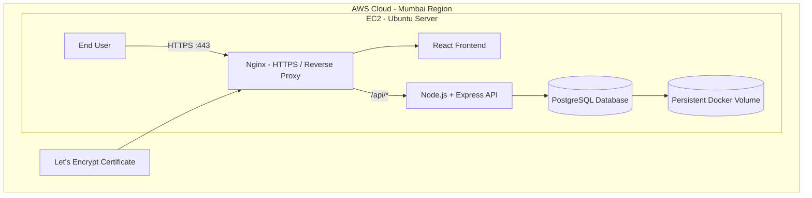
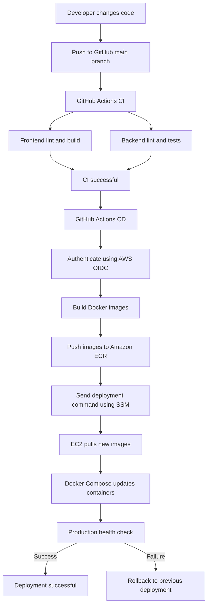

# Task Management System — System Architecture

## 1. Project Overview

The Task Management System is a full-stack web application that allows users to create, view, update, and delete tasks.

The application uses a containerized architecture and is deployed on AWS EC2. GitHub Actions automates continuous integration and deployment (CI/CD).

### Key Features

- Create, read, update, and delete tasks.
- Manage task status: PENDING, IN_PROGRESS, COMPLETED.
- Assign priorities: LOW, MEDIUM, HIGH.
- RESTful backend APIs.
- Persistent PostgreSQL database.
- Docker-based application deployment.
- Automated CI/CD using GitHub Actions.
- HTTPS communication using Let's Encrypt.
- Automated PostgreSQL backups and recovery.

## 2. Technology Stack

| Component                             | Technology                |
| ------------------------------------- | ------------------------- |
| Frontend                              | React, Vite               |
| Backend                               | Node.js, Express.js       |
| Database                              | PostgreSQL                |
| API Architecture                      | REST                      |
| Containerization                      | Docker                    |
| Container Orchestration               | Docker Compose            |
| Web Server / Reverse Proxy            | Nginx                     |
| Version Control                       | Git, GitHub               |
| CI/CD                                 | GitHub Actions            |
| Container Registry                    | Amazon ECR                |
| Cloud Infrastructure                  | AWS EC2                   |
| Deployment Execution                  | AWS Systems Manager (SSM) |
| Authentication Between GitHub and AWS | OpenID Connect (OIDC)     |
| SSL Certificate                       | Let's Encrypt / Certbot   |

## 3. High-Level Architecture

The application follows a three-tier architecture:

1. Presentation Layer — React frontend.
2. Application Layer — Node.js and Express backend.
3. Data Layer — PostgreSQL database.

### Architecture Diagram



## 4. Application Request Flow

When a user interacts with the application:

1. The browser sends an HTTPS request to the application domain.
2. Nginx receives the request on port 443.
3. Requests for frontend resources are served by Nginx.
4. Requests beginning with `/api/` are forwarded to the backend.
5. Express routes the request to the appropriate controller and service.
6. The backend communicates with PostgreSQL.
7. PostgreSQL returns the requested data.
8. Express sends a JSON response.
9. Nginx forwards the response to the browser.

### Example API Request

```text
Browser
   |
   | HTTPS
   v
Nginx
   |
   | /api/tasks
   v
Express Backend
   |
   v
PostgreSQL
   |
   v
JSON Response
```

## 5. CI/CD Architecture

The project uses GitHub Actions to automate application testing and deployment.

### CI/CD Workflow



### CI Pipeline

The CI workflow performs:

- Frontend linting.
- Frontend production build.
- Frontend automated tests.
- Backend linting.
- Backend automated tests.
- PostgreSQL-backed migration testing.

### CD Pipeline

The CD workflow performs:

1. AWS authentication using GitHub OIDC.
2. Docker image building.
3. Image publishing to Amazon ECR.
4. Deployment command execution through AWS SSM.
5. Image pulling on EC2.
6. Docker Compose application update.
7. Production health verification.
8. Rollback when deployment checks fail.

## 6. AWS Infrastructure

The production application runs on AWS.

### EC2 Instance

- Operating System: Ubuntu Server 24.04 LTS.
- Instance Type: t4g.small.
- Architecture: ARM64.
- Region: Asia Pacific (Mumbai).
- Container Runtime: Docker.
- Deployment: Docker Compose.

### Amazon ECR

Two private repositories store application images:

```text
task-management-backend
task-management-frontend
```

Images are tagged using Git commit SHA values to identify application versions.

### AWS IAM and OIDC

GitHub Actions authenticates with AWS through OpenID Connect.

This avoids storing long-lived AWS access keys in GitHub Actions.

IAM permissions are separated between:

- GitHub Actions deployment role.
- EC2 instance role.

The EC2 instance role allows the instance to retrieve container images from ECR and receive SSM commands.

## 7. Docker Architecture

The production application runs in three containers.

| Container | Responsibility                   |
| --------- | -------------------------------- |
| Frontend  | Nginx and React production build |
| Backend   | Node.js and Express application  |
| Database  | PostgreSQL data storage          |

### Container Communication

- Nginx communicates with the backend using Docker networking.
- Backend communicates with PostgreSQL using Docker networking.
- PostgreSQL is not exposed publicly.
- Backend port 5001 is not exposed publicly.
- Public application traffic enters through ports 80 and 443.

### Persistent Storage

PostgreSQL uses a Docker named volume to preserve database information across container recreation and application deployments.

The production database volume must not be removed during routine deployment or cleanup.

## 8. Security Architecture

The application incorporates several security measures.

### Network Security

- SSH restricted to the administrator's IP address.
- HTTP and HTTPS available publicly.
- PostgreSQL and backend ports are not publicly exposed.

### SSH Security

- Root SSH login disabled.
- Password authentication disabled.
- SSH key authentication used for administration.

### Container Security

- Backend application runs as a non-root Node.js user.
- PostgreSQL server process runs as the `postgres` user.
- Containers do not use privileged mode.

### Application Security

Nginx applies the following response headers:

- Strict-Transport-Security
- X-Content-Type-Options
- X-Frame-Options
- Referrer-Policy
- Permissions-Policy

### Secrets Management

- Production environment variables are stored in the EC2 environment file.
- The production `.env` file is not committed to GitHub.
- File permissions restrict access to production secrets.
- GitHub uses OIDC for AWS deployment authentication.

## 9. Database Backup and Recovery

The project includes automated PostgreSQL backup and recovery.

### Backup Strategy

- Backup tool: `pg_dump`.
- Format: PostgreSQL custom archive format.
- Frequency: Daily at 2:00 AM IST.
- Retention: Approximately seven days.
- Backup location: `/home/ubuntu/backups/`.
- Permissions: Restricted to root.

### Backup Process

```text
Cron Scheduler
      |
      v
Backup Script
      |
      v
pg_dump
      |
      v
PostgreSQL Container
      |
      v
Backup Archive
      |
      v
Retention Cleanup
```

### Recovery Testing

A separate temporary database was created to test restoration.

The backup was restored successfully, and the restored task count matched the production database.

**Important:** Current backups are stored on the same EC2 storage volume as the database. Off-instance backups are a future improvement.

## 10. SSL and HTTPS

The application uses:

- DuckDNS domain.
- Let's Encrypt SSL certificate.
- Certbot for certificate renewal.
- Nginx for HTTPS termination.

HTTP requests are redirected to HTTPS, while the Let's Encrypt challenge path remains available over HTTP.

Certbot's renewal timer checks for renewal twice daily.

A deploy hook validates and reloads Nginx after successful certificate renewal.

## 11. Deployment and Rollback

Deployment is automated through GitHub Actions.

The deployment script:

1. Receives the deployment request.
2. Authenticates with ECR from EC2.
3. Backs up the current Docker Compose configuration.
4. Updates image tags to the new Git commit SHA.
5. Pulls the new images.
6. Restarts application services.
7. Checks application health.
8. Restores the previous deployment configuration if deployment fails.

The PostgreSQL persistent volume is preserved during deployment and rollback.

## 12. Monitoring and Maintenance

Current maintenance mechanisms include:

- Application health endpoint.
- Docker container status checks.
- PostgreSQL health checks.
- Automated backup logs.
- Ubuntu unattended security updates.
- Certbot renewal timer.
- AWS monthly budget alerts.

### Health Endpoint

```http
GET /api/health
```

Expected response:

```json
{
  "status": "OK",
  "message": "Task Management API is running",
  "database": "Connected"
}
```

## 13. Future Improvements

Potential enhancements include:

- Off-instance database backups using Amazon S3.
- Application availability monitoring.
- Centralized log management.
- Automated alerts for failed backups.
- Further Nginx container hardening.
- Automated deployment notifications.

These are potential improvements and are not required for the current application to function.

## 14. Conclusion

The Task Management System demonstrates a practical full-stack application deployment using Docker, AWS, and GitHub Actions.

It incorporates automated testing, container image management, cloud deployment, HTTPS, database persistence, backup and recovery, and security hardening.

The architecture demonstrates an end-to-end software delivery workflow, from local development to production deployment and maintenance.
