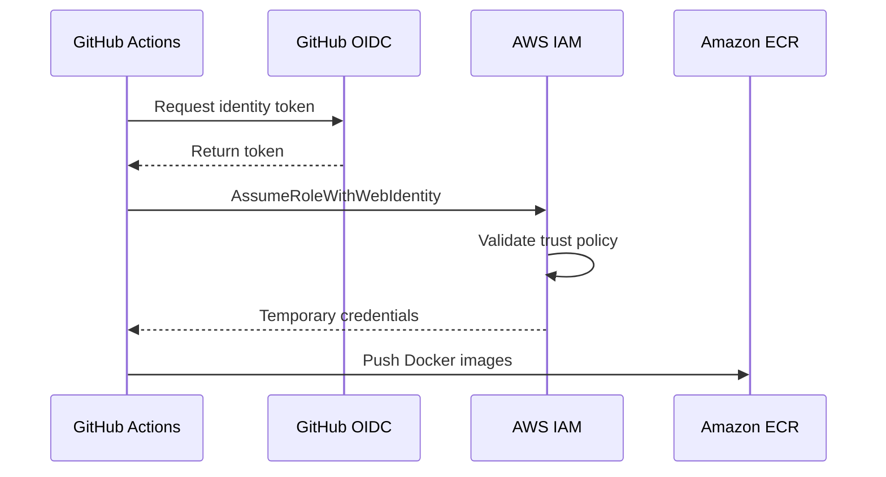

# AWS Infrastructure and Security — Task Management System

## 1. Overview

The Task Management System is deployed on Amazon Web Services (AWS).

AWS provides the infrastructure required to host the application, store Docker images, execute deployment commands, and manage cloud resources.

The deployment uses the following AWS services:

| AWS Service | Purpose |
|---|---|
| Amazon EC2 | Hosts the production application |
| Amazon ECR | Stores frontend and backend Docker images |
| AWS IAM | Manages permissions and roles |
| AWS Systems Manager | Executes deployment commands on EC2 |
| AWS Budgets | Monitors estimated AWS spending |

## 2. AWS Region and Infrastructure

The application is deployed in:

- Region: Asia Pacific (Mumbai)
- Region Code: `ap-south-1`
- Operating System: Ubuntu Server 24.04 LTS
- EC2 Instance Type: `t4g.small`
- Architecture: ARM64
- Container Runtime: Docker
- Deployment Method: Docker Compose

### EC2 Responsibilities

The EC2 instance performs the following tasks:

- Runs frontend, backend, and PostgreSQL containers.
- Pulls application images from Amazon ECR.
- Executes application deployment commands.
- Stores production environment configuration.
- Stores PostgreSQL data using persistent Docker storage.
- Creates scheduled database backups.
- Runs Nginx and handles HTTPS traffic.

## 3. Network Security

The EC2 security group controls inbound network access.

### Inbound Rules

| Port | Protocol | Source | Purpose |
|---|---|---|---|
| 22 | TCP | Administrator's IP (/32) | SSH administration |
| 80 | TCP | Anywhere IPv4 | HTTP and certificate challenges |
| 443 | TCP | Anywhere IPv4 | HTTPS application traffic |

### Restricted Ports

The following application ports are not publicly exposed:

- Backend: 5001
- PostgreSQL: 5432

The backend and database communicate through Docker's internal network.

Only Nginx exposes the application through the public HTTP and HTTPS ports.

## 4. Amazon EC2

Amazon EC2 provides the virtual server used to host the application.

### Instance Configuration

| Configuration | Value |
|---|---|
| Operating System | Ubuntu 24.04 LTS |
| Instance Type | t4g.small |
| CPU Architecture | ARM64 |
| Region | ap-south-1 |
| Root Storage | 16 GB gp3 |
| Container Runtime | Docker |
| Orchestration | Docker Compose |

### Production Directory

The application deployment files are stored at:

```text
/home/ubuntu/task-management/
```

The directory contains:

- Production Docker Compose configuration.
- Environment configuration.
- Previous Compose configuration backup.

### Storage

The EC2 root disk stores:

- Ubuntu operating system.
- Docker images and containers.
- Application deployment files.
- PostgreSQL Docker volume data.
- Database backup files.

Storage usage is periodically checked using:

```bash
df -h
```

Docker storage can be inspected using:

```bash
sudo docker system df
```

## 5. Amazon Elastic Container Registry (ECR)

Amazon ECR is used as the private Docker image registry.

Two repositories are configured:

```text
task-management-backend
task-management-frontend
```

### Image Publishing

GitHub Actions builds the application images and publishes them to ECR.

Images are tagged using Git commit SHA values.

Example:

```text
631237578239.dkr.ecr.ap-south-1.amazonaws.com/task-management-backend:<commit-sha>

631237578239.dkr.ecr.ap-south-1.amazonaws.com/task-management-frontend:<commit-sha>
```

### Image Retrieval

The EC2 instance authenticates with ECR using its attached IAM role.

It pulls the required image versions during deployment.

### Image Cleanup

Old unused images are periodically reviewed and removed to control disk usage.

The current production images and previous rollback images are retained.

## 6. AWS IAM Architecture

AWS IAM manages access to AWS resources.

The project uses separate IAM roles for GitHub Actions and EC2.

### GitHub Actions IAM Role

Role name:

```text
GitHubActions-TaskManagement-Deploy
```

Responsibilities:

- Authenticate GitHub Actions through OIDC.
- Push frontend and backend images to ECR.
- Execute deployment commands through AWS Systems Manager.
- Read the status of deployment commands.

The role uses dedicated permissions rather than AdministratorAccess.

### EC2 IAM Role

Role name:

```text
EC2-ECR-Pull-Role
```

Attached policies:

- `AmazonEC2ContainerRegistryReadOnly`
- `AmazonSSMManagedInstanceCore`

Responsibilities:

- Retrieve Docker images from ECR.
- Allow the EC2 instance to communicate with Systems Manager.
- Support remote deployment command execution.

## 7. GitHub OIDC Authentication

GitHub Actions uses OpenID Connect to obtain temporary AWS credentials.

### Why OIDC?

Storing long-lived AWS access keys inside CI/CD workflows increases credential exposure risk.

OIDC allows GitHub Actions to assume an AWS IAM role using a trusted identity token.

### Authentication Flow



### Trust Policy Restrictions

The IAM trust policy validates:

- GitHub OIDC provider.
- Token audience: `sts.amazonaws.com`.
- Repository identity.
- Authorized branch reference: `main`.

This restricts role assumption to the configured GitHub repository and branch.

## 8. AWS Systems Manager

AWS Systems Manager is used to execute deployment commands on the EC2 instance.

The GitHub Actions workflow sends commands through SSM Run Command.

### Deployment Flow

```text
GitHub Actions
      |
      v
AWS IAM OIDC Role
      |
      v
SSM SendCommand
      |
      v
EC2 Instance
      |
      v
Docker Deployment Script
      |
      v
Updated Application
```

### Benefits

- No direct SSH connection is required from GitHub Actions.
- Deployment commands are centrally managed.
- EC2 uses its attached IAM role.
- Command execution status can be inspected through AWS Systems Manager.

## 9. Production Security Configuration

### SSH Security

The EC2 SSH configuration includes:

```text
PermitRootLogin no
PasswordAuthentication no
```

SSH access is restricted to key-based authentication through the Ubuntu user.

### Automatic OS Updates

Ubuntu unattended upgrades are enabled.

Configuration:

```text
APT::Periodic::Update-Package-Lists "1";
APT::Periodic::Unattended-Upgrade "1";
```

### Container Security

- Backend application runs as the non-root `node` user.
- PostgreSQL server runs as the `postgres` user.
- Containers are not configured with privileged mode.

The Nginx frontend currently uses the standard Nginx container execution model.

### Environment Secrets

Production environment configuration is stored in:

```text
/home/ubuntu/task-management/.env
```

File permissions are restricted.

The production environment file is excluded from Git tracking.

## 10. AWS Cost Management

The project uses AWS Budgets to monitor estimated monthly costs.

### Budget Configuration

- Budget name: `Task-Management-AWS-Budget`
- Monthly budget: $10
- Scope: All AWS services
- Notifications: 50%, 80%, and 100% actual cost thresholds

### Cost Management Practices

- Monitor EC2 instance usage.
- Review EBS storage allocation.
- Avoid unnecessary AWS services.
- Remove unused local Docker images.
- Monitor ECR image storage.
- Review AWS Budgets notifications.
- Stop or terminate resources when they are no longer required.

**Important:** AWS Budgets sends alerts but does not automatically stop resources or enforce a spending limit.

The AWS Free Plan credits may offset eligible charges, but they do not guarantee that every resource is free.

## 11. Operational Verification Commands

### Check EC2 Disk Usage

```bash
df -h
```

### Check Docker Containers

```bash
sudo docker ps
```

### Check Docker Storage

```bash
sudo docker system df
```

### Check Backend Health

```bash
curl http://localhost/api/health
```

### Check Application Through HTTPS

```bash
curl -I https://mytaskman.duckdns.org
```

### Check Systems Manager Agent

```bash
sudo systemctl status snap.amazon-ssm-agent.amazon-ssm-agent
```

## 12. Conclusion

AWS provides the infrastructure for deploying and maintaining the Task Management System.

EC2 hosts the application, ECR stores Docker images, IAM controls access, OIDC provides secure GitHub authentication, and Systems Manager enables automated deployment.

The infrastructure is configured with restricted network access, dedicated IAM permissions, SSH hardening, automated operating system updates, and cost monitoring.