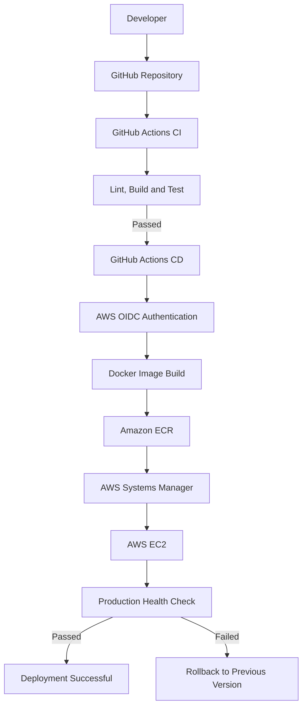
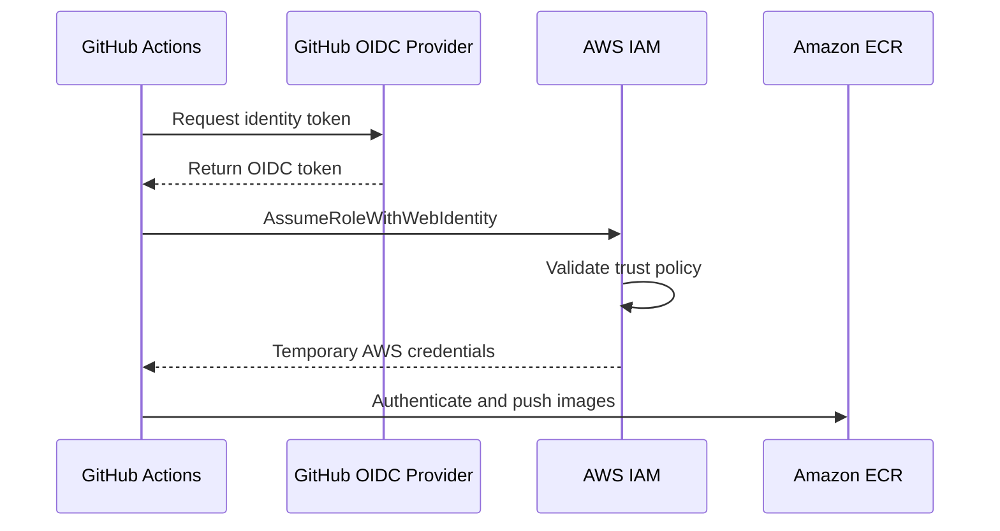

# CI/CD Pipeline — Task Management System

## 1. Overview

The Task Management System uses GitHub Actions to automate Continuous Integration (CI) and Continuous Deployment (CD).

The pipeline reduces manual deployment work and ensures that code is tested before being released to production.

### CI/CD Objectives

- Automatically test application changes.
- Build production-ready Docker images.
- Publish images to Amazon ECR.
- Deploy updated containers to AWS EC2.
- Verify application health after deployment.
- Restore the previous deployment if an update fails.

## 2. CI/CD Architecture



## 3. Continuous Integration (CI)

### Trigger

The CI workflow runs when code is pushed to the main branch or when a pull request targets the main branch.

### Frontend CI

The frontend pipeline performs:

1. Install dependencies.
2. Run lint checks.
3. Build the React application.
4. Execute frontend automated tests.

### Backend CI

The backend pipeline performs:

1. Install dependencies.
2. Run lint checks.
3. Execute backend automated tests.
4. Validate database migrations using PostgreSQL.

### Test Results

The project has successfully completed:

| Component | Tests Passed |
|---|---:|
| Frontend | 10 |
| Backend | 12 |
| Total | 22 |

A successful CI run confirms that the application passes the configured checks.

## 4. Continuous Deployment (CD)

### Trigger

The CD workflow runs when changes are pushed to the main branch. It also supports manual execution through GitHub Actions.

### Deployment Process

The deployment pipeline performs the following operations:

1. Authenticate GitHub Actions with AWS.
2. Build frontend and backend Docker images.
3. Tag images using the Git commit SHA.
4. Push images to Amazon ECR.
5. Send a deployment command to EC2 through AWS Systems Manager.
6. Authenticate EC2 with Amazon ECR.
7. Pull the new Docker images.
8. Update the production Docker Compose configuration.
9. Start the updated application containers.
10. Perform a production health check.

## 5. AWS Authentication Using OIDC

GitHub Actions uses OpenID Connect (OIDC) to authenticate with AWS IAM.

### Why OIDC?

Traditional authentication often requires storing long-lived AWS access keys as GitHub secrets.

OIDC provides temporary credentials by allowing GitHub Actions to assume an IAM role.

### Authentication Flow



### IAM Roles

Two primary IAM roles are used:

**GitHubActions-TaskManagement-Deploy**

- Allows GitHub Actions to authenticate through OIDC.
- Provides permissions to publish Docker images to ECR.
- Allows deployment commands to be sent through SSM.

**EC2-ECR-Pull-Role**

- Attached to the EC2 instance.
- Allows the instance to pull images from ECR.
- Provides permissions required for Systems Manager.

IAM permissions are scoped to the resources and operations required by the deployment workflow.

## 6. Amazon ECR Image Management

Amazon Elastic Container Registry stores the production Docker images.

### Repositories

```text
task-management-backend
task-management-frontend
```

### Image Tagging

Images use Git commit SHA values as tags.

Example:

```text
task-management-backend:<commit-sha>
task-management-frontend:<commit-sha>
```

### Benefits

- Identifies the exact application version.
- Supports deployment traceability.
- Makes rollback to a previous image possible.
- Avoids relying exclusively on the mutable `latest` tag.

## 7. AWS Systems Manager Deployment

GitHub Actions uses AWS Systems Manager Run Command to execute deployment operations on EC2.

This avoids requiring the GitHub Actions runner to connect directly to EC2 over SSH.

### Deployment Flow

```text
GitHub Actions
      |
      v
AWS Systems Manager
      |
      v
EC2 Instance
      |
      v
Authenticate with ECR
      |
      v
Pull New Docker Images
      |
      v
Update Docker Compose
      |
      v
Restart Application Containers
      |
      v
Health Check
```

The EC2 instance uses its attached IAM role to authenticate with ECR and retrieve the required images.

## 8. Deployment and Rollback

The deployment script is located at:

```text
deploy/deploy.sh
```

### Deployment Safety

Before changing the production deployment, the script backs up the existing Compose configuration.

It then updates image tags to the new Git commit SHA and pulls the corresponding images.

### Health Check

After deployment, the script verifies the application using:

```bash
curl -fsS http://localhost/api/health
```

A successful response confirms that the backend health endpoint is accessible and the database connection is working.

### Rollback Process

If deployment fails:

1. The deployment script detects the failure.
2. The previous Compose configuration is restored.
3. Previously deployed images are used.
4. Application containers are restarted.
5. A health check verifies the restored application.

The production PostgreSQL volume is preserved during rollback.

### Rollback Testing

A controlled manual rollback test was performed.

The test deliberately used invalid image tags to simulate a deployment failure. The previous Compose configuration was restored, the old images were pulled, and the application health check succeeded.

The result confirmed that the manual rollback recovery procedure worked.

Note: This test validated the recovery procedure, not every failure branch of the GitHub Actions deployment script.

## 9. GitHub Repository Configuration

The deployment workflow uses GitHub repository variables to provide non-secret configuration values.

| Variable | Purpose |
|---|---|
| `AWS_ROLE_ARN` | AWS deployment role |
| `AWS_REGION` | AWS deployment region |
| `ECR_BACKEND_REPOSITORY` | Backend ECR repository |
| `ECR_FRONTEND_REPOSITORY` | Frontend ECR repository |
| `EC2_INSTANCE_ID` | Target EC2 instance |

AWS credentials are obtained through OIDC rather than stored as long-lived credentials in the workflow.

## 10. CI/CD Benefits

The implemented pipeline provides:

- Automated testing before deployment.
- Consistent Docker image builds.
- Centralized image storage.
- Secure AWS authentication.
- Automated remote deployment.
- Deployment version tracking.
- Production health verification.
- A previous-version recovery mechanism.
- Reduced manual operational work.

## 11. Troubleshooting

| Problem | Possible Cause | Investigation |
|---|---|---|
| CI workflow fails | Lint, build or test error | Review GitHub Actions logs |
| OIDC authentication fails | Trust policy mismatch | Verify OIDC subject and audience |
| ECR push fails | IAM permissions or authentication | Check deployment role and ECR permissions |
| EC2 cannot pull images | Expired ECR token or missing permissions | Authenticate again using EC2 IAM role |
| SSM command fails | Instance connectivity or IAM issue | Check SSM managed-node status and command output |
| Container fails to start | Configuration or application error | Inspect Docker Compose and container logs |
| Health check fails | Backend or database unavailable | Check `/api/health` and container logs |

## 12. Conclusion

The CI/CD pipeline automates the delivery of the Task Management System from GitHub to AWS EC2.

GitHub Actions handles testing, image creation, and deployment orchestration, while Amazon ECR stores application images and AWS Systems Manager executes deployment commands on EC2.

The pipeline includes health verification and a rollback mechanism to improve deployment reliability and reduce manual intervention.