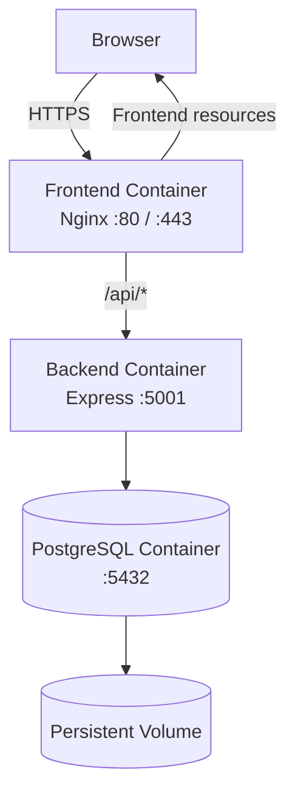
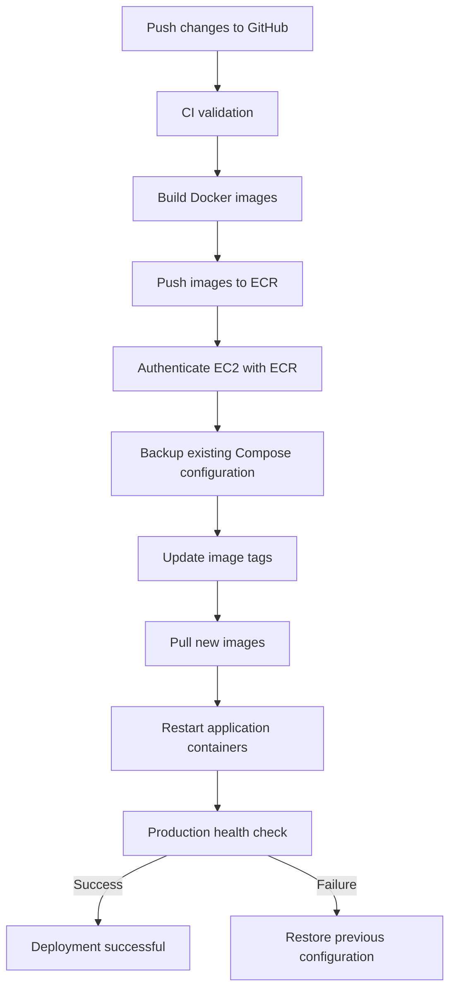

# Deployment, Docker, Backup and Recovery

## 1. Overview

The Task Management System uses Docker and Docker Compose to run its frontend, backend, and database services.

Production deployment is automated through GitHub Actions, Amazon ECR, and AWS Systems Manager.

This document explains the container architecture, deployment process, application verification, database backup, and recovery procedures.

## 2. Docker Architecture

The production environment consists of three Docker containers.

| Container | Technology | Responsibility |
|---|---|---|
| task-management-frontend | Nginx | Serves React application and proxies API requests |
| task-management-backend | Node.js, Express | Handles application APIs and business logic |
| task-management-db | PostgreSQL | Stores application data |

### Container Communication



### Network Configuration

- Nginx accepts public traffic on ports 80 and 443.
- Backend communicates internally on port 5001.
- PostgreSQL communicates internally on port 5432.
- Backend and database ports are not publicly exposed.

## 3. Docker Image Configuration

The project maintains separate Dockerfiles for the frontend and backend.

### Backend Dockerfile

The backend image uses Node.js 24.

The build process:

1. Uses the official Node.js image.
2. Sets `/app` as the working directory.
3. Copies package configuration files.
4. Installs dependencies using `npm ci`.
5. Copies application source files.
6. Assigns application file ownership to the `node` user.
7. Switches to the non-root `node` user.
8. Starts the Express application.

### Frontend Dockerfile

The frontend uses a multi-stage Docker build.

**Stage 1 — Build**

- Uses Node.js 24.
- Installs dependencies.
- Builds the React application using Vite.

**Stage 2 — Production**

- Uses Nginx Alpine.
- Copies the React production build into the Nginx document root.
- Copies the Nginx configuration.
- Serves the frontend through Nginx.

## 4. Docker Compose

Docker Compose manages the production application containers.

Production configuration is located at:

```text
/home/ubuntu/task-management/compose.yaml
```

The production configuration defines:

- PostgreSQL database service.
- Backend application service.
- Frontend Nginx service.
- Persistent database volume.
- Service dependencies and health checks.
- Application environment variables.
- HTTPS certificate mounts.

### Persistent Database Storage

PostgreSQL uses a Docker named volume.

This allows database data to survive normal container recreation and application deployments.

**Important:** Never use `docker compose down -v` in production unless intentionally deleting the database volume and all its data.

## 5. Local Development

Local development uses the project's root Docker Compose configuration.

The local application can be started using:

```bash
docker compose up -d --build
```

### Local URLs

| Service | URL |
|---|---|
| Frontend | http://localhost:8080 |
| Backend | http://localhost:5001 |
| API Health | http://localhost:5001/api/health |

To inspect running containers:

```bash
docker compose ps
```

To view logs:

```bash
docker compose logs -f
```

To stop the local application:

```bash
docker compose down
```

## 6. Production Deployment

Production deployment is automated through GitHub Actions.

### Deployment Trigger

A push to the main branch triggers the configured CI/CD workflows.

### Deployment Sequence



### Production Application Directory

```text
/home/ubuntu/task-management/
```

### Production Deployment Verification

Check container status:

```bash
sudo docker ps
```

Check application health:

```bash
curl http://localhost/api/health
```

Check the public application:

```bash
curl -I https://mytaskman.duckdns.org
```

Expected API response:

```json
{
  "status": "OK",
  "message": "Task Management API is running",
  "database": "Connected"
}
```

## 7. Rollback Procedure

The deployment process maintains a backup of the previous Compose configuration.

When a deployment fails, the deployment script attempts to restore the previous configuration and application image versions.

### Rollback Process

1. Detect deployment failure.
2. Restore the previous Compose configuration.
3. Pull the previously deployed images if required.
4. Restart application containers.
5. Verify application health.

### Manual Recovery Considerations

Before manually recovering a deployment:

- Inspect the current Compose configuration.
- Identify the last known working image tags.
- Preserve the production environment file.
- Preserve the PostgreSQL volume.
- Verify the restored application health.

Never delete production database storage during rollback.

## 8. Database Backup Strategy

PostgreSQL backups are automated using `pg_dump`.

### Backup Configuration

| Property | Configuration |
|---|---|
| Database | task_management |
| Database user | task_app |
| Container | task-management-db |
| Backup utility | pg_dump |
| Backup format | Custom archive |
| Schedule | Daily at 2:00 AM IST |
| Retention | Approximately 7 days |
| Backup directory | /home/ubuntu/backups/ |

### Backup Script

The backup script is located at:

```text
/usr/local/bin/backup-task-management.sh
```

It performs the following operations:

1. Creates a timestamped backup filename.
2. Creates the backup directory if necessary.
3. Sets restrictive file permissions.
4. Runs `pg_dump` inside the PostgreSQL container.
5. Verifies that the backup exists and is not empty.
6. Sets backup file permissions to 600.
7. Removes old backup files.

### Backup Command

The script uses:

```bash
docker exec task-management-db \
  pg_dump -U task_app -d task_management -Fc
```

### Backup Scheduling

The root crontab contains:

```cron
30 20 * * * /usr/local/bin/backup-task-management.sh >> /var/log/task-management-backup.log 2>&1
```

EC2 uses UTC.

Therefore:

- UTC schedule: 20:30.
- India schedule: 02:00 AM the following day.

### Backup Verification

List available backups:

```bash
sudo ls -lh /home/ubuntu/backups/
```

Inspect backup logs:

```bash
sudo cat /var/log/task-management-backup.log
```

Verify the backup archive using PostgreSQL's restore utility:

```bash
sudo docker cp /home/ubuntu/backups/<backup-file>.dump \
  task-management-db:/tmp/backup.dump
```

Then:

```bash
sudo docker exec task-management-db \
  pg_restore --list /tmp/backup.dump
```

## 9. Database Recovery

A backup is useful only when it can be restored successfully.

The project includes a separate-database restoration test.

### Restoration Test Procedure

1. Select a valid backup archive.
2. Copy it into the PostgreSQL container.
3. Create a temporary database.
4. Restore the backup into the temporary database.
5. Verify restored tables and records.
6. Compare restored data with the production database.
7. Remove the temporary test database.

### Example Restore Command

```bash
sudo docker exec task-management-db \
  pg_restore -U task_app \
  -d task_management_restore_test \
  --no-owner /tmp/backup.dump
```

### Recovery Verification

The restoration test completed successfully.

The restored database contained two task records, matching the production database at the time of testing.

The temporary test database was subsequently removed.

### Important Recovery Limitation

Current backup archives are stored on the same EC2 EBS disk as the production database.

These backups protect against certain logical mistakes and container failures, but they do not protect against complete loss of the EC2 storage volume.

Off-instance backup storage, such as Amazon S3, remains a potential future improvement.

## 10. SSL Certificate Renewal

The application uses Let's Encrypt certificates managed by Certbot.

### Certificate Location

```text
/etc/letsencrypt/live/mytaskman.duckdns.org/
```

Important certificate files:

- `fullchain.pem`
- `privkey.pem`

### Automatic Renewal

The Certbot systemd timer is enabled.

It checks for renewal twice daily.

Check timer status:

```bash
sudo systemctl status certbot.timer
```

### Nginx Reload Hook

A deploy hook is configured at:

```text
/etc/letsencrypt/renewal-hooks/deploy/reload-nginx.sh
```

The script:

1. Validates the Nginx configuration.
2. Reloads Nginx inside the frontend container.

This ensures Nginx reloads after a successful certificate renewal.

## 11. Maintenance Commands

### View Running Containers

```bash
sudo docker ps
```

### View Container Logs

```bash
sudo docker logs task-management-backend
sudo docker logs task-management-frontend
sudo docker logs task-management-db
```

### Check Docker Storage

```bash
sudo docker system df
```

### Check Disk Usage

```bash
df -h
```

### Inspect Production Compose Configuration

```bash
cd /home/ubuntu/task-management
sudo docker compose config --quiet
```

### Check Backup Schedule

```bash
sudo crontab -l
```

### Check SSL Renewal Timer

```bash
sudo systemctl status certbot.timer
```

## 12. Operational Safety Rules

Follow these practices when maintaining the production environment:

1. Never delete the PostgreSQL persistent volume during routine cleanup.
2. Never expose PostgreSQL or backend ports publicly.
3. Never commit production secrets to GitHub.
4. Preserve the previous working image version for rollback.
5. Verify application health after every deployment.
6. Test database backups through restoration.
7. Review disk space before large deployments.
8. Check container logs when an application fails.
9. Avoid deleting Docker images that are required for rollback.
10. Monitor AWS usage and budget alerts.

## 13. Conclusion

Docker and Docker Compose provide a consistent application runtime for local development and production.

GitHub Actions automates application deployment, while Amazon ECR stores versioned images.

PostgreSQL backup and recovery procedures protect application data against several operational failures.

Together, these practices provide a practical deployment and maintenance workflow for the Task Management System.